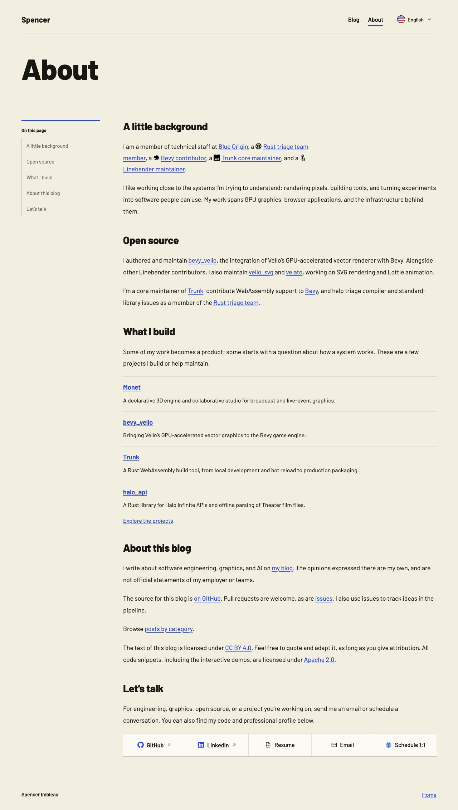

# Website UI audit and shadcn refresh

Audited November 23, 2026. The portfolio pairs bold typography and a playful portrait
with a clearer page hierarchy, consistent controls, and dedicated project and About content.
The homepage and About structure take inspiration from [den.dev](https://den.dev),
using this site's own colors, portrait, decorations, and copy.

| Finding                                                         | Change                                                                                                                                                             |
| --------------------------------------------------------------- | ------------------------------------------------------------------------------------------------------------------------------------------------------------------ |
| Uppercase display styling reduced readability.                  | Sentence-case Barlow headings and controls, a personal greeting, and a full biography at every screen size.                                                        |
| The portrait lost its distinctive framing.                      | Offset blue frame, corner marks, rotated name sticker, star, and scribble; brief entrance motion respects reduced-motion preferences.                              |
| Projects contained too many visual labels.                      | Title and description only, with a boxed external-link marker. Every project opens in a new tab.                                                                   |
| The homepage did not surface recent writing.                    | Latest lists three published posts as date, title, and description rows from a Jekyll-generated JSON feed; the blog link remains available if the feed fails.      |
| Contact actions lacked a clear home.                            | One bar contains GitHub, LinkedIn, Resume (PDF icon), Email, and Schedule 1:1 (Calendly logo); email opens a copyable popover.                                     |
| Profile switching and biography expansion added distractions.   | Removed the homepage profile dropdown and expansion controls. Header links are Blog then About, with the profile name linking home.                                |
| About content was split across the blog and website.            | Migrated ownership, contribution links, categories, and license details into the translated site About page. The old blog URL redirects there.                     |
| Cross-page anchors could miss their target while React mounted. | Restore fragment scrolling after sections mount, with regression coverage.                                                                                         |
| MUI and custom controls duplicated the UI system.               | Owned shadcn/ui components, Radix menus and popovers, and Tailwind tokens; matching static Jekyll CSS.                                                             |
| Document controls and email feedback were incomplete.           | Language switching, consistent active/alternate navigation, an Open PDF link beside an accessible download icon with live file size, and translated copy feedback. |

## Content and routing

- Monet, bevy_vello, Trunk, and halo_api are configured in `profiles.json`.
  Cards have no category, technology, or decorative icon labels. No Mastodon link is added.
- About, projects, navigation, and controls are translated into English, French, and Persian.
  About follows the résumé route conventions, including bare and language-prefixed routes,
  local profile paths, canonical metadata, sitemap entries, and CloudFront routing.
- About, Latest, and Projects belong to Spencer. Sara retains her own profile content.
- How I Work remains accessible through the résumé page, with a bounded scrollable article
  and Go Back outside. Its navigation keeps the filled active and outlined alternate styles.
- Blog content and the résumé PDF remain English only. Blog background remains `#f3eedf`.
- README files were not changed.

## Validation

- `pnpm check`: Prettier, ESLint, TypeScript, 218 tests, and the Vite build.
- `HOMEPAGE_SITE=spencer pnpm build` and `HOMEPAGE_SITE=sara pnpm build`, including Jekyll.
- `terraform -chdir=terraform fmt -check -recursive`,
  `terraform -chdir=terraform init -backend=false -input=false -lockfile=readonly`,
  and `terraform -chdir=terraform validate`.
- Browser checks of the revised portfolio: 1280px homepage and About; 375px homepage;
  320px English homepage and email reveal, French About, and Persian homepage. Checked horizontal overflow,
  header wrapping, language changes, cross-page project scrolling, email copy feedback, outside-click/Escape dismissal and focus return,
  résumé/How I Work button hierarchy, project new-tab targets, and blog About redirects.
- Earlier refresh checks also covered the joint selector, Sara résumé state, mobile blog index
  and article, keyboard menu opening/Escape/focus return, biography expansion, article scrolling,
  image enlargement/Escape, and the PDF download.
- Theme text contrast calculations: ink on cream 15.39:1, muted text on cream 5.22:1,
  and white on primary blue 7.16:1. These are token checks, not a WCAG certification.

The in-app browser displayed the external résumé iframe but not its PDF contents;
embedded PDF rendering remains a browser-dependent manual check. The direct download
worked. This was a visual and interaction audit, not a comprehensive screen-reader,
physical-device, or cross-browser certification.

## Component maintenance

`components.json` configures shadcn's `new-york` registry and the `@/` aliases.
Button, card, dropdown-menu, and popover source originated from the official
[shadcn registry](https://ui.shadcn.com/r/styles/new-york/button.json).
Local adjustments set 44px control targets, strengthen button focus rings, and omit
menu and popover animations. The upstream MIT notice is retained in `src/components/ui/LICENSE.md`.
Use `src/index.css` for app tokens and shared layouts, and `public/blog-theme.css`
for the corresponding static blog presentation.
