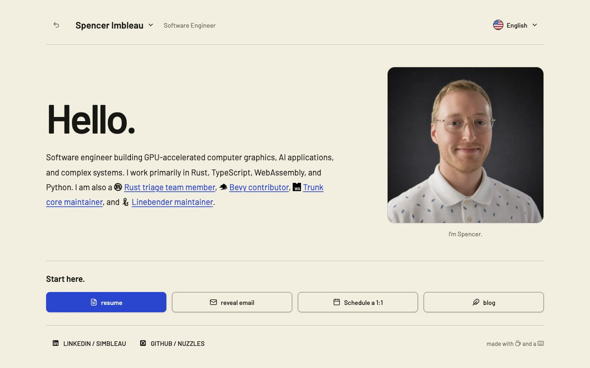

# Website UI audit and shadcn refresh

Audited November 23, 2026. The refresh keeps the cream-and-blue identity while
making typography, controls, spacing, and navigation more consistent.

| Finding                                                                               | Change                                                                                                                                               |
| ------------------------------------------------------------------------------------- | ---------------------------------------------------------------------------------------------------------------------------------------------------- |
| Oversized uppercase headings competed with the biography and article content.         | Sentence-case Barlow headings, a smaller type scale, and comfortable paragraph spacing.                                                              |
| Offset blue shadows, portrait corner marks, and rotated stickers dominated the pages. | Simple portrait framing, subtle card borders, small radii, and restrained shadows.                                                                   |
| MUI, custom button styles, and standalone blog CSS duplicated the visual system.      | Owned shadcn/ui buttons, cards, and Radix dropdowns; Tailwind 4 semantic tokens; MUI and Emotion removed. Jekyll stays static and uses matching CSS. |
| Small controls and weak footer contrast reduced usability.                            | 44px button/menu targets, visible focus rings, stronger secondary button outlines, readable muted text, and reduced-motion styles.                   |
| Document pages lacked an immediate language switch.                                   | Language menu beside the existing résumé/How I Work navigation; filled current page and outlined alternate page.                                     |
| Failed email copying gave no explanation.                                             | Accessible success feedback and a visible translated error; the email link remains usable. Timers are cleaned up on unmount.                         |
| The PDF's direct link appeared only during delayed loading.                           | Persistent Open PDF link and a disabled download button while a download is in progress.                                                             |
| The blog index lacked a top-level heading.                                            | Latest posts is an h1 when the page has no separate title; post links are h2 headings. Font preloads match the new typography.                       |

## Preserved behavior

- English, French, and Persian routes, language preferences, metadata, and RTL layout.
- Spencer-only How I Work, reached from the résumé page, with a bounded scrollable
  article and Go back outside it. Sara's résumé remains an unavailable state.
- English-only blog content and résumé PDF, biography copy and affiliation icons,
  contact links, blog media controls, and profile switching.
- The blog CSS proxy boundary fix; cream blog background remains `#f3eedf`.
- README files were not changed.

## Validation

- `pnpm check`: formatting, ESLint, TypeScript, 175 tests, and the Vite build.
- `HOMEPAGE_SITE=spencer pnpm build` and `HOMEPAGE_SITE=sara pnpm build`, including Jekyll.
- Browser checks: desktop homepage and blog; 375px homepage, blog index and article;
  320px joint selector, Sara résumé state, and French/Persian document navigation;
  768px Persian homepage. Checked horizontal overflow, language links, active document
  styles, keyboard menu opening/Escape/focus return, biography expansion, article End
  scrolling, and image enlargement/Escape.
- Downloaded Spencer's PDF through the refreshed Download button successfully.
- Theme text contrast calculations: ink on cream 15.39:1, muted text on cream 5.22:1,
  and white on primary blue 7.16:1. These are token checks, not a WCAG certification.

The in-app browser displayed the external résumé iframe but not its PDF contents;
embedded PDF rendering remains a browser-dependent manual check. The direct download
worked. This was a visual and interaction audit, not a comprehensive screen-reader,
physical-device, or cross-browser certification.

## Component maintenance

`components.json` configures shadcn's `new-york` registry and the `@/` aliases.
Button, card, and dropdown-menu source originated from the official
[shadcn registry](https://ui.shadcn.com/r/styles/new-york/button.json).
Local adjustments set 44px control targets, strengthen button focus rings, and omit
menu animations. The upstream MIT notice is retained in `src/components/ui/LICENSE.md`.
Use `src/index.css` for app tokens and shared layouts, and `public/blog-theme.css`
for the corresponding static blog presentation.
